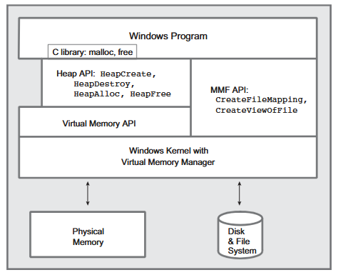

## Address Space of a Proces

- The private, virtual view of memory that the operating system assigns the running process.
- This gives the process the illusion it is allocated continguous memiry spaces.


## Memory Mapping Files

- A memory mapped file in an OS is a mechanism that links a portion of a file on disk directly into a process's virtual memory address space.
- This allows the process to access the file contents directly through memory operations.
- Instead of repeatedly calling `read`, `write` ... etc ... system calls to copy data into the user space buffers, memory mapping allows us to directly access file contents using memory pointers. In Linux this could be achieved using `mmap`. 
- No physical data is loaded into RAM immediately, the system only allocates the memory address range. The data is only loaded into the RAM when the file operation is called, like dynamically.
- Dynamic memory related variables are allocated in the Heap region, so OS creates a paging or virtual address space for this value/object. This address may be non continguos in the PHYSICAL RAM but paging makes it look like its contiguos. Without fragmentation(contiguous memory) the program/process can perform simpler array element lookups without complex math, The MMU does the heavy lifting in the background, without paging we would as programmers would have had to perform complex array element lookups, program would have gotten more complex.

## Page Faults

- an except or interrupt raised by the Memory Management Unit(MMU) when a process is trying to access a memory address(page) that is not currenly mapped to the Physical RAM.

- a program must be written to minimize number of page faults.

### RESONS WHY PAGE FAULTS ARE LET TO HAPPEN

- page faults are unmapped virtual memory addresses.
- not all pages are mapped when the process is running and thats to optimally use the physical memory. only the pages used actively are loaded, and rest are left unmapped.

### TYPES OF PAGE FAULTS

- minor page fault (required data is in RAM but the page is not linked to that address yet)
- major page fault (required data is not in RAM, and must be fetched from secondary storage before linking the address)
- illegal page fault (process trying to read data on an address its not permitted to. this causes segmentation faults. can happen if the process is trying to access the memory address when its already terminated by the OS)

### WINDOWS MEMORY MANAGEMENT ARCHITECTURE DIAGRAM




## DLLs

- DLLs stands for Dynamic Linked Library
- Not executable directly unlike `.exe` we double click and execute.
- These DLLs are shared by multiple processes having same code so instead of creating multiple copies of the same code and consuming disk space, these DLLs are created so that multiple processes can share them.
- Advantages:
    - memory effificent:
        - not wasting disk space to create multiple redundant copies of the same code. one common point of access.
    - code reusability
        - the DLL is reused by multiple processes having the same checks or operations required to perform.
    - easier updates: 
        - only update that DLL code part instead of updating each and every program
            

## ADVANTAGES OF MEMORY MAPPED FILES OVER STANDARD I/O

* **Zero-copy performance.** 
    - Standard I/O copies file data from the disk into the OS kernel cache, and then copies it a second time into your program's user buffer. Memory mapping points your variable directly at the kernel cache, cutting out the extra copy and saving both CPU cycles and RAM.
* **No system call overhead during reads and writes.** 
    - Calling `ReadFile` or `WriteFile` in a loop forces the CPU to constantly switch between User Mode and Kernel Mode. With a memory-mapped file, you read and write using normal C/C++ pointers (`ptr[i]`), which execute at full CPU memory speed without OS context switches.
* **Lazy loading (Demand Paging).** 
    - Mapping a 10 GB file does not load 10 GB into RAM. Windows only loads small 4 KB chunks ("pages") from the disk into physical RAM at the exact moment your code tries to read those specific memory addresses.
* **Effortless random access.** 
    - Jumping back and forth inside a huge file with standard I/O requires constant `SetFilePointer` calls to move the file cursor. With memory mapping, jumping to any byte in the file is instant pointer math (`basePtr + offset`).
* **Built-in Inter-Process Communication (IPC).** 
    - Two or more separate programs can map the exact same file or shared memory object at the same time. Because Windows maps both programs' virtual pointers to the same underlying physical RAM pages, changes made by one program appear instantly to the other.
* **Simpler parsing of structured files.** 
    - If a file contains C-style structs, arrays, or binary headers, you can cast the mapped pointer directly to your struct type (`MyHeader* hdr = (MyHeader*)pBuf;`) instead of manually reading, parsing, and unpacking byte buffers.

---

# Memory Mapped Files

- As we talked earlier about memory mapped files being an os mechanism that links a portion of the disk directly to a process's virtual address space. So memory mapped file is the HIGH LEVEL CONCEPT.


# Kernel File Object

- A kernel file object (often referred to in operating systems like Windows or Linux) is a data structure maintained inside the kernel's address space that represents an open file, device, pipe, or directory


## 4. CreateFileMapping()

- `CreateFileMapping()` creates a **kernel file mapping object** which has a **handle**, on an open file and then map all or part of the file to the process's virtual address space. File object can be named so that they can be accessed by other processes. 

- mapping of a file means creating a direct link of the file but `CreateFileMapping()` doesn't build the link yet. It only builds the blueprint saying this file will be linked and creates the **kernel file mapping object**.


### Arguments required by CreateFileMapping()

```c
HANDLE CreateFileMapping(
  HANDLE                hFile,
  LPSECURITY_ATTRIBUTES lpFileMappingAttributes,
  DWORD                 flProtect,
  DWORD                 dwMaximumSizeHigh,
  DWORD                 dwMaximumSizeLow,
  LPCTSTR               lpName
);
```

The `CreateFileMappingA` (or `CreateFileMappingW`) function creates or opens a named or unnamed file mapping object for a specified file.


* **`hFile`** (`HANDLE`): Handle to a file from `CreateFile`. Pass `INVALID_HANDLE_VALUE` to create an object backed by the system paging file for shared memory.
* **`lpFileMappingAttributes`** (`LPSECURITY_ATTRIBUTES`): Pointer to a security structure determining if child processes can inherit the handle. Pass `NULL` for default security.
* **`flProtect`** (`DWORD`): Page protection for the file view, such as `PAGE_READONLY` or `PAGE_READWRITE`. Must match the access rights used when opening `hFile`.
* **`dwMaximumSizeHigh`** (`DWORD`): High-order 32 bits of the maximum size of the file mapping object.
* **`dwMaximumSizeLow`** (`DWORD`): Low-order 32 bits of the maximum size. If both size parameters are `0`, the object matches the current file size.
* **`lpName`** (`LPCSTR` / `LPCWSTR`): Name of the mapping object (can use `Global\` or `Local\` prefixes). Pass `NULL` for an unnamed object.

## Return Value

* **Success:** Returns a `HANDLE` to the newly created file mapping object. If an object with the same name already existed, it returns a handle to the existing object, and calling `GetLastError()` returns `ERROR_ALREADY_EXISTS`.
* **Failure:** Returns `NULL`. Call `GetLastError()` for extended error details.


## OpenFileMapping

Opens an existing named file mapping object (`OpenFileMappingA` for ANSI, `OpenFileMappingW` for Unicode, defined in `winbase.h` via `windows.h`).

## Syntax

```c
HANDLE OpenFileMappingW(
  [in] DWORD   dwDesiredAccess,
  [in] BOOL    bInheritHandle,
  [in] LPCWSTR lpName
);
```

## Arguments required by OpenFileMappingW()

* **`dwDesiredAccess` (`DWORD`)**: Access rights to the file mapping object (checked against its security descriptor).
  * Common flags: `FILE_MAP_READ`, `FILE_MAP_WRITE`, `FILE_MAP_ALL_ACCESS`, `FILE_MAP_COPY`, `FILE_MAP_EXECUTE`.
* **`bInheritHandle` (`BOOL`)**: Handle inheritance flag for child processes created via `CreateProcess`.
  * `TRUE`: Child processes can inherit the handle.
  * `FALSE`: Handle cannot be inherited.
* **`lpName` (`LPCSTR` / `LPCWSTR`)**: Null-terminated name of the existing file mapping object.
  * Supports `Global\` or `Local\` namespace prefixes; the remainder cannot contain backslashes (`\`).

## Return Values

* **Success**: An open `HANDLE` to the specified file mapping object.
* **Failure**: `NULL` (call `GetLastError()` for extended error info, such as `ERROR_FILE_NOT_FOUND`).


## MapViewOfFile

Maps a view of a file mapping object into the address space of a calling process (`memoryapi.h` via `windows.h`).

## Syntax

```c
LPVOID MapViewOfFile(
  [in] HANDLE hFileMappingObject,
  [in] DWORD  dwDesiredAccess,
  [in] DWORD  dwFileOffsetHigh,
  [in] DWORD  dwFileOffsetLow,
  [in] SIZE_T dwNumberOfBytesToMap
);
```

## Arguments required by MapViewofile()

* **`hFileMappingObject` (`HANDLE`)**: A handle to a file mapping object returned by `CreateFileMapping` or `OpenFileMapping`.
* **`dwDesiredAccess` (`DWORD`)**: Type of access to the file view, which determines the page protection of the pages.
  * Common flags: `FILE_MAP_ALL_ACCESS`, `FILE_MAP_READ`, `FILE_MAP_WRITE`, `FILE_MAP_COPY` (copy-on-write), `FILE_MAP_EXECUTE`.
* **`dwFileOffsetHigh` (`DWORD`)**: High-order `DWORD` of the file offset where the view begins.
* **`dwFileOffsetLow` (`DWORD`)**: Low-order `DWORD` of the file offset where the view begins.
  * Note: The combined offset must be a multiple of the system's memory allocation granularity (typically 64 KB).
* **`dwNumberOfBytesToMap` (`SIZE_T`)**: Number of bytes of the file mapping to map to the view.
  * Set to `0` to map from the specified offset all the way to the end of the file mapping object.

## Return Values

* **Success**: The starting memory address (`LPVOID`) of the mapped view.
* **Failure**: `NULL` (call `GetLastError()` for extended error info).

## UnmapViewOfFile

- We release or free the virtual address space or range for the memory mapped file we created inside the process.

* **Header:** `memoryapi.h` (include `Windows.h`)
* **Library:** `Kernel32.lib`
* **DLL:** `Kernel32.dll`

---

## Arguments
```c
BOOL UnmapViewOfFile(
  [in] LPCVOID lpBaseAddress
);
```
* **`lpBaseAddress` (`LPCVOID`)**: Pointer to the base address of the mapped view to unmap. Must be identical to the value returned by a previous call to `MapViewOfFile` or `MapViewOfFileEx`. (No size argument is needed; Windows always unmaps the entire view).


## Return Values
* **Nonzero (`TRUE`)**: The function succeeded.
* **Zero (`FALSE`)**: The function failed. Call `GetLastError()` for extended error details.


## SUMMARY 


| Win32 API Function | Purpose & Need | What It Returns |
| :--- | :--- | :--- |
| `CreateFileMapping` | Creates a named or unnamed file mapping kernel object. It defines the maximum size and page protection (read/write) for a disk file or system pagefile. | A `HANDLE` to the file mapping object. |
| `OpenFileMapping` | Allows a secondary process to access an existing named file mapping object created by another process for IPC. | A `HANDLE` to the existing file mapping object. |
| `MapViewOfFile` | Reserves a region of the calling process's virtual address space and links it to all or part of the file mapping object. | A void pointer (`LPVOID`) to the starting memory address. |
